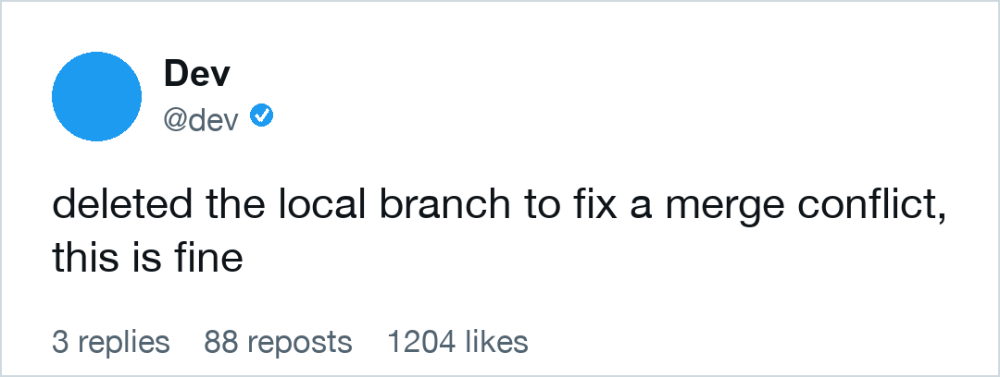
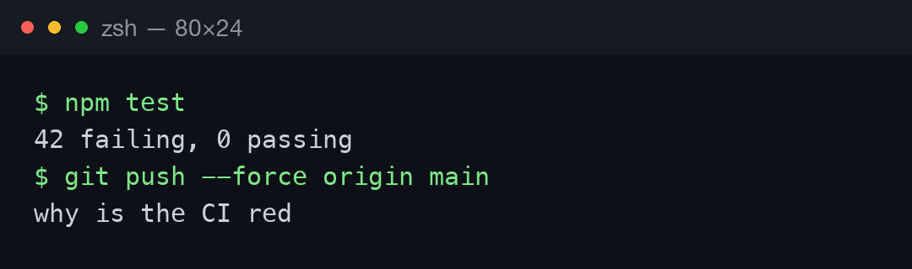

# Troll Library

[](https://github.com/nathan5580/troll-library/actions/workflows/test.yml)
[](LICENSE)
[](https://github.com/nathan5580/troll-library/releases)

Nine agent skills for harmless social pranks: the "I deleted everything" bit, generated meme cards, ASCII banners, evidence-based roasts, rickrolls, fake macOS notifications, fabricated incidents, and corporate passive-aggression.

Everything runs locally. Prank payloads are text, PIL-rendered PNGs, and `osascript` notifications. No script deletes, moves, or writes to your files, and every bit that claims damage prints its own reveal.

Works wherever an agent can read files and run `python3`: **OMP**, **Claude Code**, **Codex**, **Cursor**, **Copilot**, **Gemini CLI**, or anything that reads `AGENTS.md`. Skills use the common `SKILL.md` convention (`name` + `description` frontmatter), so skill-aware harnesses discover them and the rest read them as plain Markdown.

## Install

```bash
git clone https://github.com/nathan5580/troll-library.git && cd troll-library
bash install.sh        # every harness skill dir found on this machine
```

| Harness | Install |
|---|---|
| OMP | `omp plugin marketplace add nathan5580/troll-library` → `omp plugin install troll-library@troll-library` |
| Claude Code | `/plugin marketplace add nathan5580/troll-library` → `/plugin install troll-library@troll-library` |
| Any harness with a skills dir | `bash install.sh --target ~/.claude/skills` (repeatable, `--copy` for real copies) |
| Cursor, Copilot, Gemini CLI, other agents | point them at `AGENTS.md`, or copy `skills/` into their skills directory |
| Anything else | read `skills/troll-protocol/SKILL.md`, then the skill you want |

Auto-detected targets: `~/.omp/agent/skills`, `~/.claude/skills`, `~/.codex/skills`, `~/.agents/skills`. Authored skills and foreign symlinks are never overwritten; existing installs of this pack are refreshed in place. `bash install.sh --uninstall` removes only what this repo installed.

Requirements: `python3` 3.10+. `meme-smith` also needs Pillow. `fake-alert` is macOS-only and prints the reveal instead when `osascript` is missing.

## Skills

| Skill | What it does | Artifact |
|---|---|---|
| `troll-protocol` | Safety floor every other skill reads first | rules |
| `fake-delete` | Believable `rm` / force-push / `DROP DATABASE` catastrophe | terminal transcript |
| `meme-smith` | Impact memes, fake tweets, terminal cards, chat bubbles | PNG |
| `ascii-troll` | Block banners, cow speech bubbles, terminal art | text |
| `brutal-roast` | Roasts built from git history, TODOs and test counts | text |
| `rickroll` | Disguised links and fake build progress | text |
| `fake-alert` | Fake macOS notifications (presets or custom) with an automatic reveal | notification |
| `fake-outage` | Fabricated `curl`, status page and status card | text + PNG |
| `corporate-bot` | Passive-aggressive compliance rewrites | text |

## Demo

Cards rendered by `meme-smith` — nothing below is a screenshot of a real service:






`ascii-troll` for places a PNG cannot go:

```text
#### ###. .##. #... #... #### ###.
.#.. #..# #..# #... #... #... #..#
.#.. ###. #..# #... #... ###. #..#
.#.. #.#. #..# #... #... #... #..#
.#.. #..# .##. #### #### #### ###.

 ________________________________________
/ should have read the migration docs    \
\ before dropping the column             /
 ----------------------------------------
        \   ^__^
         \  (oo)\_______
            (__)\       )\/\
                ||----w |
                ||     ||
```

`fake-delete` — the headline bit, with the reveal attached:

```text
$ rm -vrf /Users/you/project/*
removed 'README.md'
removed 'install.sh'
removed 'skills/fake-delete/panic.py'
removed 'tests/smoke.py'
rm: 41.2 KiB removed

🧌 PRANK — nothing was deleted / force-pushed / dropped. 4 files checked, nothing on this machine changed.
```

## Try one

Run each script from its own skill directory.

```bash
python3 panic.py --scenario deleted --files 6 --delay 2                              # skills/fake-delete
python3 memegen.py --style tweet --text "my code compiles" --name Dev --handle @dev  # skills/meme-smith
python3 ascii.py --mode banner --text "TROLLED"                                      # skills/ascii-troll
python3 rickroll.py --mode progress --task "npm install" --steps 20                  # skills/rickroll
python3 alert.py --preset disk --delay 4                                             # skills/fake-alert
```

## The safety floor

`skills/troll-protocol/SKILL.md` is normative for every skill in the pack.

- **Reveal guaranteed** — anything claiming loss, damage, or a live incident carries `🧌 prank — nothing actually happened` in the same message, or the script prints it.
- **No real damage** — no `rm`, `mv`, `truncate`, `git reset/clean`, DB connections, or writes outside the meme output directory.
- **Banned claims** — money, health, legal/police/immigration, live breach or compromised account, employment status, fabricated misconduct of a real person.
- **Banned targets** — protected traits, appearance, family, grief, addiction, a person's real mistakes.
- **Distress stop** — "is this real", "stop", "not funny", or visible panic ends the bit immediately.
- **Nothing is sent for you** — the agent produces artifacts; a human forwards them.

## Layout

```text
skills/<skill>/SKILL.md      skill instructions (frontmatter: name, description)
skills/<skill>/*.py          stdlib scripts (Pillow only for memegen.py)
tests/smoke.py               every script plus an install/uninstall round trip
install.sh                   multi-harness installer
.claude-plugin/              plugin + marketplace manifests (OMP, Claude Code)
.cursor/rules/               Cursor rule mirroring the floor
AGENTS.md, CLAUDE.md         entry points for harnesses without a skill loader
```

## Contributing

`python3 tests/smoke.py` must pass before a PR. CI runs it on Ubuntu and macOS. New pranks belong behind the floor: self-revealing or paired with a reveal, no real-world harm, no real endpoint calls.

## License

MIT — see [LICENSE](LICENSE).
